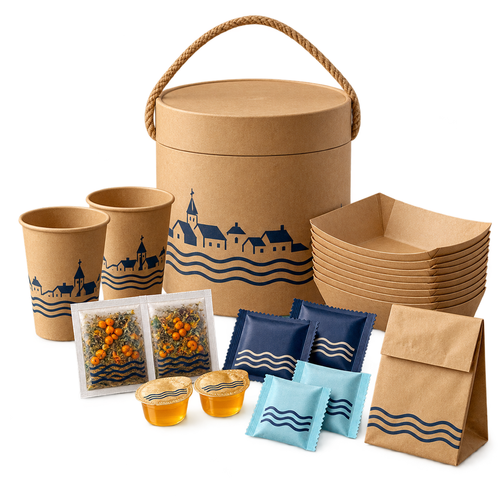

# Пирогорск — утверждённое направление айдентики

01.11.2026 пользователь утвердил оформление «Балтийского пикник-сета»:
«сохрани айдентику как в наборе она супер».

## Главный визуальный ориентир

[Оригинальный PNG](picnic-set-20261101/picnic-set.png) и
[исходный промпт встроенного imagegen](picnic-set-20261101/README.md)
остаются источником для следующих материалов.

## Что переносим в следующие материалы

- Натуральный тёплый крафт с заметной фактурой бумаги и картона.
- Тёмно-синяя графика: приморский пироговый город, башенки, крыши и плавные волны.
- Светло-голубые морские детали, небольшие янтарные и облепиховые акценты.
- Простая печать на упаковке: город и волны объединяют тубус, стаканчики,
  пакеты и небольшие принадлежности в одну семью.
- Объёмная предметная подача: реалистичные материалы, мягкий естественный
  свет, короткие контактные тени и ясные силуэты.
- Чистая композиция со свободным пространством вокруг предметов;
  на сайте — светлая поверхность, хорошо читаемый текст и привычные действия.

Это ориентир для упаковки, наборов и будущих иллюстраций Пирогорска.
Существующий логотип с пироговым городом и маленький знак «пирог-солнышко»
сохраняют свои роли. На дату фиксации визуальное оформление опубликованного
сайта и ассортимент не менялись.

## Связанные материалы

- [Опубликованный пикник-сет и проверки](../qa/picnic-set-20261101/README.md).
- [Балтийская гастро-концепция — сохранённый исходник](../research/baltic-gastro-20261101/README.md).
- [Бэклог проекта: BRAND-01](../BACKLOG.md).
