# Брифы выпусков · Пирогорск

Источники ниже предназначены для первичной проверки, а метатексты подготовлены как черновики. Предложенные новые адреса сверены с текущей картой сайта. Актуальные часы, меню, цены и детали рецептуры проверяются к дате выпуска.

## CNT-101 · 19.11 · Новогодний стол с пирогами на 6–12 человек

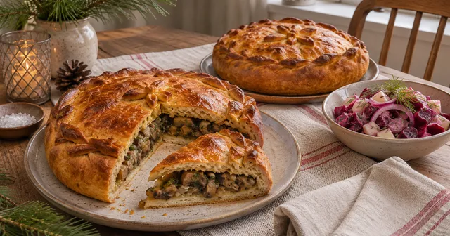

**Новая статья** · `/journal/novogodniy-stol-s-pirogami/` · Стол и подача

- **Вопрос читателя.** Собрать меню с одним горячим блюдом и десертом.
- **Что добавить.** Три состава стола для 6, 8 и 12 гостей; пример с закусками; список закупок и таймлайн подачи.
- **SEO-заголовок.** Новогодний стол с пирогами на 6–12 человек | Пирогорск
- **Описание.** Готовые варианты праздничного стола на 6, 8 и 12 гостей. Как выбрать сытные и сладкие пироги, собрать закуски и вовремя всё подать.
- **Перелинковка.** [kak-vybrat-pirogi-na-kompaniyu](https://pirogorsk.ru/journal/kak-vybrat-pirogi-na-kompaniyu/), [skolko-piroga-na-cheloveka](https://pirogorsk.ru/journal/skolko-piroga-na-cheloveka/), [kak-narezat-pirog](https://pirogorsk.ru/journal/kak-narezat-pirog/). [Рассчитать количество пирогов](https://pirogorsk.ru/podbor/).
- **Обложка.** Два пирога на зимнем столе со скромным декором. [Исходник PNG](artwork/novogodniy-stol-s-pirogami.png) · [OG 1200×630](og/novogodniy-stol-s-pirogami.jpg).
- **Две врезки.** Таблица меню на 6/8/12 гостей и часы подготовки и подачи.
- **До выпуска.** Сверить расчёт с калькулятором и явно обозначить, где пироги служат основным блюдом.
- **Источники.** [Калькулятор Пирогорска](https://pirogorsk.ru/podbor/), [Роспотребнадзор — рекомендации к праздничному столу](https://zpp.rospotrebnadzor.ru/news/federal/570062), [King Arthur Baking — How to Bake Pie](https://www.kingarthurbaking.com/learn/pie).

## CNT-102 · 20.11 · Почему трескается пирог: диагностика по виду трещины

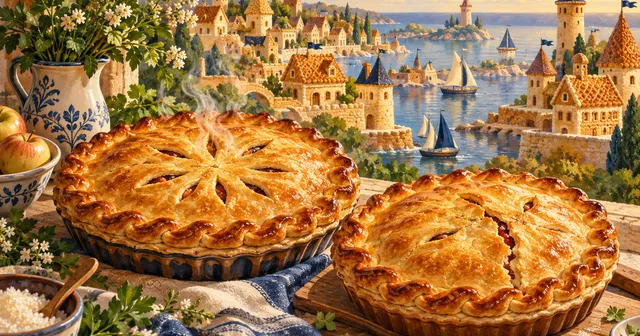

**Обновление** · `/journal/pochemu-pirog-treskaetsya/` · Приёмы и хранение

- **Вопрос читателя.** Определить причину по месту и моменту появления трещины.
- **Что добавить.** Разделить трещины по краю и в центре; показать разницу между вентиляционным надрезом и аварийной трещиной; добавить таблицу исправлений для следующей выпечки.
- **SEO-заголовок.** Почему трескается пирог: диагностика по виду трещины | Пирогорск
- **Описание.** Трещина сбоку или по центру пирога? Разбираем, что подскажет форма трещины и как изменить сборку и выпечку в следующий раз.
- **Перелинковка.** [pochemu-u-piroga-syroe-dno](https://pirogorsk.ru/journal/pochemu-u-piroga-syroe-dno/), [drozhzhevoe-testo-dlya-pirogov](https://pirogorsk.ru/journal/drozhzhevoe-testo-dlya-pirogov/), [yablochnyy-pirog-v-duhovke](https://pirogorsk.ru/journal/yablochnyy-pirog-v-duhovke/). [Посмотреть пироги и начинки](https://pirogorsk.ru/menu/).
- **Обложка.** Два золотистых пирога с надрезами для пара на фоне иллюстрированного пирогового города. Действующая обложка статьи.
- **Две врезки.** Макро трёх типов трещин и матрица симптомов и действий.
- **До выпуска.** Сверить запросы и URL в Search Console. Причины формулировать как диагностику, проверить на примерах.
- **Источники.** [King Arthur Baking — Pie Baking Guide](https://www.kingarthurbaking.com/learn/guides/pie-baking), [King Arthur Baking — Pie Crust Guide](https://www.kingarthurbaking.com/learn/guides/pie-crust).

## CNT-103 · 21.11 · Что из выпечки приготовить заранее к празднику

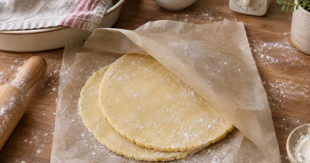

**Новая статья** · `/journal/vypechka-zaranee-prazdnik/` · Приёмы и хранение

- **Вопрос читателя.** Разнести работу по дням до праздничного обеда.
- **Что добавить.** График по видам теста и начинок; что приготовить накануне, а что оставить на день подачи; подготовка морозилки и духовки.
- **SEO-заголовок.** Что из выпечки приготовить заранее к празднику | Пирогорск
- **Описание.** Какие заготовки для пирогов сделать заранее, что оставить накануне и как распределить время выпечки в день праздника.
- **Перелинковка.** [kak-zamorozit-pirog](https://pirogorsk.ru/journal/kak-zamorozit-pirog/), [kak-hranit-pirogi](https://pirogorsk.ru/journal/kak-hranit-pirogi/), [kak-razogret-pirog-v-apartamentah](https://pirogorsk.ru/journal/kak-razogret-pirog-v-apartamentah/). [Посмотреть пироги и начинки](https://pirogorsk.ru/menu/).
- **Обложка.** Пласты теста на пергаменте в домашней кухне. [Исходник PNG](artwork/vypechka-zaranee-prazdnik.png) · [OG 1200×630](og/vypechka-zaranee-prazdnik.jpg).
- **Две врезки.** Шкала за 2 дня / накануне / в день и список маркировки заготовок.
- **До выпуска.** Сроки для конкретных начинок брать из проверенного источника или маркировки.
- **Источники.** [King Arthur Baking — How to Bake Pie](https://www.kingarthurbaking.com/learn/pie), [King Arthur Baking — Freeze Pie Crust](https://www.kingarthurbaking.com/blog/2025/11/05/freeze-pie-crust), [Роспотребнадзор — рекомендации к праздничному столу](https://zpp.rospotrebnadzor.ru/news/federal/570062).

## CNT-104 · 22.11 · Зимняя прогулка в Зеленоградске с тёплым перекусом

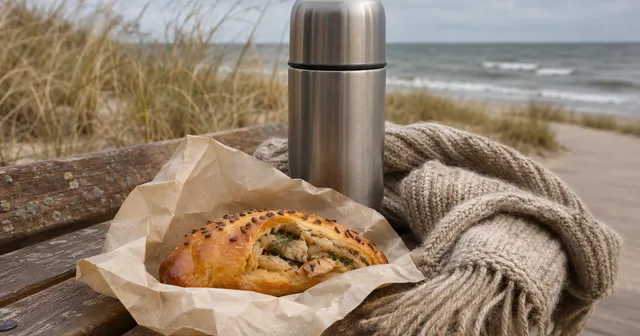

**Новая статья** · `/journal/zimnyaya-progulka-zelenogradsk-s-perekusom/` · Городские гиды · Зеленоградск

- **Вопрос читателя.** Собрать короткую прогулку от вокзала с местом для паузы.
- **Что добавить.** Схемы на 45 и 90 минут; варианты при ветре и дожде; покупка перед прогулкой и запасной вариант в помещении.
- **SEO-заголовок.** Зимняя прогулка в Зеленоградске с тёплым перекусом | Пирогорск
- **Описание.** Два коротких зимних маршрута по Зеленоградску от вокзала. Где сделать паузу с тёплым перекусом и как перестроить прогулку при ветре.
- **Перелинковка.** [gde-poest-v-zelenogradske](https://pirogorsk.ru/journal/gde-poest-v-zelenogradske/), [pekarni-i-pirogi-v-zelenogradske](https://pirogorsk.ru/journal/pekarni-i-pirogi-v-zelenogradske/), [kofe-i-vypechka-v-zelenogradske](https://pirogorsk.ru/journal/kofe-i-vypechka-v-zelenogradske/). [Посмотреть подборки для Зеленоградска](https://pirogorsk.ru/zelenogradsk/).
- **Обложка.** Термос и выпечка на скамье у зимнего моря. [Исходник PNG](artwork/zimnyaya-progulka-zelenogradsk-s-perekusom.png) · [OG 1200×630](og/zimnyaya-progulka-zelenogradsk-s-perekusom.jpg).
- **Две врезки.** Две схематичные петли и точки, где можно согреться.
- **До выпуска.** Время ходьбы сверить по карте. Адреса, часы и зимние ограничения брать у самих площадок.
- **Источники.** [Туристический центр — Зеленоградск](https://visit-kaliningrad.ru/blog/zelenogradsk/), [Туристический центр — календарь Калининградской области](https://visit-kaliningrad.ru/calendar/), [Роспотребнадзор — рекомендации к праздничному столу](https://zpp.rospotrebnadzor.ru/news/federal/570062).

## CNT-105 · 23.11 · Как нарезать пирог: круглый, прямоугольный и с хрупкой коркой

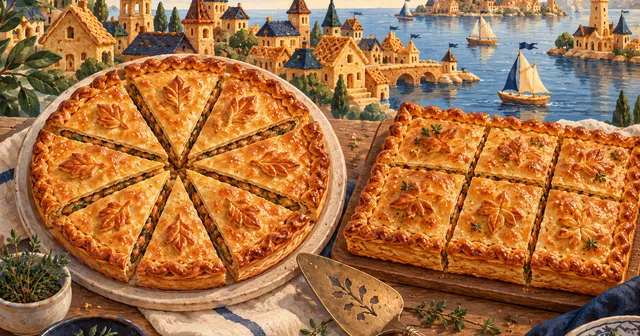

**Обновление** · `/journal/kak-narezat-pirog/` · Стол и подача

- **Вопрос читателя.** Разделить пирог поровну, сохранив форму кусков.
- **Что добавить.** Дополнить действующую схему прямоугольным листом и примерами на 9 и 12 частей; показать, как подавать хрупкую корку.
- **SEO-заголовок.** Как нарезать пирог: круглый, прямоугольный и с хрупкой коркой | Пирогорск
- **Описание.** Способы нарезки круглого и прямоугольного пирога. Как получить равные куски и сохранить хрупкую корку при подаче.
- **Перелинковка.** [skolko-piroga-na-cheloveka](https://pirogorsk.ru/journal/skolko-piroga-na-cheloveka/), [pirog-500-g-ili-1-kg](https://pirogorsk.ru/journal/pirog-500-g-ili-1-kg/), [mini-pirogi-ili-tselyy-pirog](https://pirogorsk.ru/journal/mini-pirogi-ili-tselyy-pirog/). [Рассчитать количество пирогов](https://pirogorsk.ru/podbor/).
- **Обложка.** Круглый и прямоугольный пироги, нарезанные на порции на фоне иллюстрированного пирогового города. Действующая обложка статьи.
- **Две врезки.** Новая схема прямоугольного пирога и пример на весах.
- **До выпуска.** Измерить порции по фактическому весу. Проверить схему на 320 px и с клавиатуры.
- **Источники.** [Калькулятор Пирогорска](https://pirogorsk.ru/podbor/), [King Arthur Baking — How to Bake Pie](https://www.kingarthurbaking.com/learn/pie).

## CNT-106 · 24.11 · Пирог с картошкой и грибами в духовке

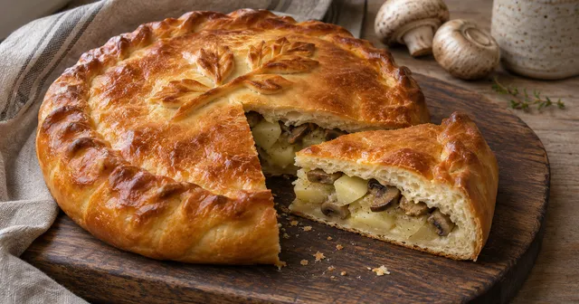

**Новая статья** · `/journal/pirog-s-kartoshkoy-i-gribami-recept/` · Рецепты

- **Вопрос читателя.** Испечь закрытый пирог с картофельно-грибной начинкой.
- **Что добавить.** Граммовки и форма; подготовка картофеля и грибов; сборка и надрез; готовность и частые ошибки.
- **SEO-заголовок.** Пирог с картошкой и грибами в духовке | Пирогорск
- **Описание.** Закрытый пирог с картофелем и грибами в духовке. Состав начинки, сборка, надрез и признаки готовности.
- **Перелинковка.** [pirog-s-kartoshkoy-i-syrom](https://pirogorsk.ru/journal/pirog-s-kartoshkoy-i-syrom/), [drozhzhevoe-testo-dlya-pirogov](https://pirogorsk.ru/journal/drozhzhevoe-testo-dlya-pirogov/), [pochemu-u-piroga-syroe-dno](https://pirogorsk.ru/journal/pochemu-u-piroga-syroe-dno/). [Посмотреть пироги и начинки](https://pirogorsk.ru/menu/).
- **Обложка.** Закрытый пирог в разрезе с картофелем и грибами. [Исходник PNG](artwork/pirog-s-kartoshkoy-i-gribami-recept.png) · [OG 1200×630](og/pirog-s-kartoshkoy-i-gribami-recept.jpg).
- **Две врезки.** Крупно начинка перед сборкой и разрез готовой корки.
- **До выпуска.** Проверить авторскую раскладку на одной форме. Без заявления о тестировании до его проведения.
- **Источники.** [King Arthur Baking — Pie Baking Guide](https://www.kingarthurbaking.com/learn/guides/pie-baking), [King Arthur Baking — How to Bake Pie](https://www.kingarthurbaking.com/learn/pie), [Роспотребнадзор — рекомендации к праздничному столу](https://zpp.rospotrebnadzor.ru/news/federal/570062).

## CNT-107 · 25.11 · Как заморозить пирог целиком или порциями

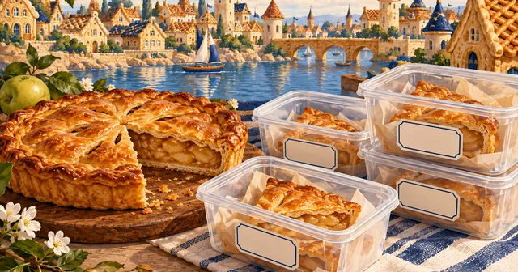

**Обновление** · `/journal/kak-zamorozit-pirog/` · Приёмы и хранение

- **Вопрос читателя.** Выбрать способ подготовки и разморозки под тип пирога.
- **Что добавить.** Развести заготовку, готовый целый пирог и кусочки; предложить маркировку, упаковку и способы разморозки.
- **SEO-заголовок.** Как заморозить пирог целиком или порциями | Пирогорск
- **Описание.** Что выбрать для готового пирога, кусков и заготовки. Как упаковать, подписать и разморозить выпечку разных типов.
- **Перелинковка.** [kak-hranit-pirogi](https://pirogorsk.ru/journal/kak-hranit-pirogi/), [kak-razogret-pirog-v-apartamentah](https://pirogorsk.ru/journal/kak-razogret-pirog-v-apartamentah/), [pochemu-u-piroga-syroe-dno](https://pirogorsk.ru/journal/pochemu-u-piroga-syroe-dno/). [Посмотреть пироги и начинки](https://pirogorsk.ru/menu/).
- **Обложка.** Куски пирога в контейнерах для замораживания на фоне иллюстрированного пирогового города. Действующая обложка статьи.
- **Две врезки.** Слои упаковки и схема выбора целиком / порционно.
- **До выпуска.** Различить безопасность и качество. Сверить с маркировкой, не давать универсальные сроки.
- **Источники.** [King Arthur Baking — Freeze Pie Crust](https://www.kingarthurbaking.com/blog/2025/11/05/freeze-pie-crust), [Роспотребнадзор — рекомендации к праздничному столу](https://zpp.rospotrebnadzor.ru/news/federal/570062), [King Arthur Baking — How to Bake Pie](https://www.kingarthurbaking.com/learn/pie).

## CNT-108 · 26.11 · Где поесть в Калининграде зимой: план на короткий день

**Обновление** · `/journal/kaliningrad-zimoy-gde-poest/` · Городские гиды · Калининград и область

- **Вопрос читателя.** Найти тёплую остановку между прогулкой и вечерними планами.
- **Что добавить.** Обновить существующий зимний гид; добавить 2 сценария с помещением и временем на переход, мини-таблицу оговорок по выходным.
- **SEO-заголовок.** Где поесть в Калининграде зимой: план на короткий день | Пирогорск
- **Описание.** Где сделать тёплую остановку на прогулке по Калининграду зимой. Два сценария с проверкой адресов, времени работы и формата еды.
- **Перелинковка.** [gde-poest-ryadom-s-ostrovom-kanta](https://pirogorsk.ru/journal/gde-poest-ryadom-s-ostrovom-kanta/), [zavtraki-v-kaliningrade](https://pirogorsk.ru/journal/zavtraki-v-kaliningrade/), [pozdniy-uzhin-v-kaliningrade](https://pirogorsk.ru/journal/pozdniy-uzhin-v-kaliningrade/). [Посмотреть подборки для Калининграда](https://pirogorsk.ru/kaliningrad/).
- **Обложка.** Зимний стол с пирогом, супом и чаем у окна на вымышленный заснеженный пироговый город. Действующая обложка статьи.
- **Две врезки.** Схема двух коротких маршрутов и карточка адресов с датой сверки.
- **До выпуска.** Время работы кухни отдельно от времени работы зала, только подтверждённые даты.
- **Источники.** [Туристический центр — календарь Калининградской области](https://visit-kaliningrad.ru/calendar/), [Туристический центр — Калининград](https://visit-kaliningrad.ru/blog/kaliningrad-za-3-dnya/).

## CNT-109 · 27.11 · Грушевый тарт с миндалём: рецепт и нарезка

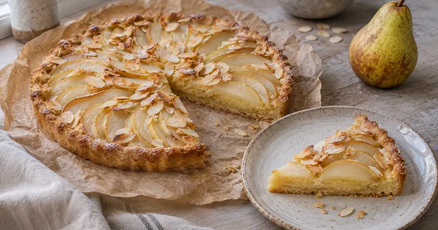

**Новая статья** · `/journal/pirog-s-grushey-i-mindalem/` · Рецепты

- **Вопрос читателя.** Испечь открытый тарт и выбрать груши нужной плотности.
- **Что добавить.** Песочная основа; подготовка груш; миндальный слой; признаки готовности; остывание перед нарезкой.
- **SEO-заголовок.** Грушевый тарт с миндалём: рецепт и нарезка | Пирогорск
- **Описание.** Как выбрать груши, приготовить песочную основу и миндальный слой, испечь открытый тарт и дать ему остыть перед нарезкой.
- **Перелинковка.** [pesochnoe-testo-dlya-kisha](https://pirogorsk.ru/journal/pesochnoe-testo-dlya-kisha/), [sladkie-pirogi-k-chayu](https://pirogorsk.ru/journal/sladkie-pirogi-k-chayu/), [kak-narezat-pirog](https://pirogorsk.ru/journal/kak-narezat-pirog/). [Посмотреть пироги и начинки](https://pirogorsk.ru/menu/).
- **Обложка.** Открытый грушевый тарт с миндалём на пергаменте. [Исходник PNG](artwork/pirog-s-grushey-i-mindalem.png) · [OG 1200×630](og/pirog-s-grushey-i-mindalem.jpg).
- **Две врезки.** Выкладка долек и разрез после остывания.
- **До выпуска.** Проверить свою раскладку. Миндаль отметить как аллерген, не заявлять универсальные замены.
- **Источники.** [King Arthur Baking — Pear & Almond Tart](https://www.kingarthurbaking.com/recipes/pear-almond-tart-recipe), [King Arthur Baking — How to Bake Pie](https://www.kingarthurbaking.com/learn/pie), [King Arthur Baking — Pie Crust Guide](https://www.kingarthurbaking.com/learn/guides/pie-crust).

## CNT-110 · 28.11 · Кофе и выпечка в Зеленоградске: по пути от вокзала

**Обновление** · `/journal/kofe-i-vypechka-v-zelenogradske/` · Городские гиды · Зеленоградск

- **Вопрос читателя.** Выбрать быструю остановку перед морем или обратной электричкой.
- **Что добавить.** Разбить проверенные точки по сценарию кофе с собой / посидеть; добавить доступность с коляской при подтверждении; убрать устаревшие часы.
- **SEO-заголовок.** Кофе и выпечка в Зеленоградске: по пути от вокзала | Пирогорск
- **Описание.** Где взять кофе и выпечку по дороге от вокзала к морю в Зеленоградске. Идеи для быстрого перекуса и паузы в помещении.
- **Перелинковка.** [gde-pozavtrakat-v-zelenogradske](https://pirogorsk.ru/journal/gde-pozavtrakat-v-zelenogradske/), [pekarni-i-pirogi-v-zelenogradske](https://pirogorsk.ru/journal/pekarni-i-pirogi-v-zelenogradske/), [gde-poest-v-zelenogradske](https://pirogorsk.ru/journal/gde-poest-v-zelenogradske/). [Посмотреть подборки для Зеленоградска](https://pirogorsk.ru/zelenogradsk/).
- **Обложка.** Две чашки кофе, круассан, вишнёвая слойка и крендель на столе у моря в вымышленном балтийском пироговом городе. Действующая обложка статьи.
- **Две врезки.** Схема по пути к морю и таблица форматов остановки.
- **До выпуска.** Ссылки на меню и официальные страницы каждой упомянутой точки. Цены только с датой.
- **Источники.** [Туристический центр — Зеленоградск](https://visit-kaliningrad.ru/blog/zelenogradsk/), [Туристический центр — календарь Калининградской области](https://visit-kaliningrad.ru/calendar/).

## CNT-111 · 29.11 · Как подарить пирог: упаковка и записка с составом

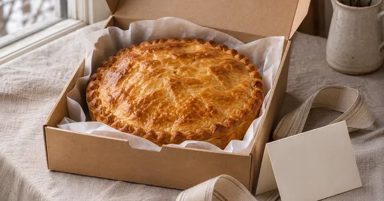

**Новая статья** · `/journal/kak-podarit-pirog/` · Стол и подача

- **Вопрос читателя.** Подготовить съедобный подарок хозяевам и довезти его целым.
- **Что добавить.** Три варианта подарка; пищевая упаковка; что указать на записке; когда охлаждение требуется производителем.
- **SEO-заголовок.** Как подарить пирог: упаковка и записка с составом | Пирогорск
- **Описание.** Как выбрать коробку для пирога, закрепить выпечку и добавить записку с составом. Варианты для визита в гости и небольшого подарка.
- **Перелинковка.** [kak-perevezti-pirog](https://pirogorsk.ru/journal/kak-perevezti-pirog/), [sostav-piroga-i-allergeny](https://pirogorsk.ru/journal/sostav-piroga-i-allergeny/), [sedobnye-suveniry-iz-kaliningrada](https://pirogorsk.ru/journal/sedobnye-suveniry-iz-kaliningrada/). [Рассчитать количество пирогов](https://pirogorsk.ru/podbor/).
- **Обложка.** Золотистый пирог в крафтовой коробке с запиской. [Исходник PNG](artwork/kak-podarit-pirog.png) · [OG 1200×630](og/kak-podarit-pirog.jpg).
- **Две врезки.** Схема упаковки и образец карточки с составом и датой.
- **До выпуска.** Упаковка для контакта с пищей. Интервалы хранения только по источнику и конкретному продукту.
- **Источники.** [Роспотребнадзор — рекомендации к праздничному столу](https://zpp.rospotrebnadzor.ru/news/federal/570062), [Калькулятор Пирогорска](https://pirogorsk.ru/podbor/), [King Arthur Baking — How to Bake Pie](https://www.kingarthurbaking.com/learn/pie).

## CNT-112 · 30.11 · Какие пироги выбрать на компанию с разными вкусами

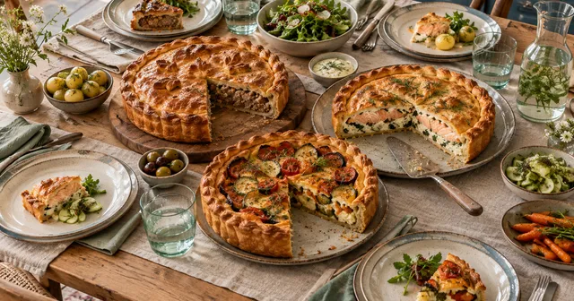

**Обновление** · `/journal/kak-vybrat-pirogi-na-kompaniyu/` · Стол и подача

- **Вопрос читателя.** Собрать набор, учитывая предпочтения гостей и состав.
- **Что добавить.** Сценарии с мясной, растительной и сладкой начинками; выбор двух размеров; проверка состава для гостей с ограничениями.
- **SEO-заголовок.** Какие пироги выбрать на компанию с разными вкусами | Пирогорск
- **Описание.** Как выбрать начинки и форматы пирогов для компании с разными вкусами. Примеры наборов и вопросы о составе перед подачей.
- **Перелинковка.** [skolko-piroga-na-cheloveka](https://pirogorsk.ru/journal/skolko-piroga-na-cheloveka/), [sostav-piroga-i-allergeny](https://pirogorsk.ru/journal/sostav-piroga-i-allergeny/), [mini-pirogi-ili-tselyy-pirog](https://pirogorsk.ru/journal/mini-pirogi-ili-tselyy-pirog/). [Рассчитать количество пирогов](https://pirogorsk.ru/podbor/).
- **Обложка.** Три пирога с разными начинками и сервировка общего стола на шестерых. Действующая обложка статьи.
- **Две врезки.** Матрица вкусов и пример двух наборов с калькулятором.
- **До выпуска.** Брать позиции из действующего каталога, сверить сценарий подбора.
- **Источники.** [Калькулятор Пирогорска](https://pirogorsk.ru/podbor/), [Роспотребнадзор — рекомендации к праздничному столу](https://zpp.rospotrebnadzor.ru/news/federal/570062).

## CNT-113 · 01.12 · Несладкая галета с тыквой и сыром

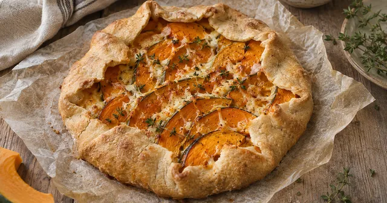

**Новая статья** · `/journal/galeta-s-tykvoy-i-syrom/` · Рецепты

- **Вопрос читателя.** Испечь открытую галету без формы.
- **Что добавить.** Раскатка и защипы; влажность тыквы; толщина ломтиков; раскладка начинки; готовность дна.
- **SEO-заголовок.** Несладкая галета с тыквой и сыром | Пирогорск
- **Описание.** Рецепт открытой несладкой галеты с тыквой и сыром. Как раскатать основу, защипнуть края и пропечь дно без формы.
- **Перелинковка.** [pirog-s-tykvoy-sladkiy-i-sytnyy](https://pirogorsk.ru/journal/pirog-s-tykvoy-sladkiy-i-sytnyy/), [pochemu-u-piroga-syroe-dno](https://pirogorsk.ru/journal/pochemu-u-piroga-syroe-dno/), [pesochnoe-testo-dlya-kisha](https://pirogorsk.ru/journal/pesochnoe-testo-dlya-kisha/). [Посмотреть пироги и начинки](https://pirogorsk.ru/menu/).
- **Обложка.** Открытая галета с ломтиками тыквы и сыром на пергаменте. [Исходник PNG](artwork/galeta-s-tykvoy-i-syrom.png) · [OG 1200×630](og/galeta-s-tykvoy-i-syrom.jpg).
- **Две врезки.** Схема складывания края и нижняя корка после выпечки.
- **До выпуска.** Сравнить с существующим гидом о тыкве, который владеет выбором вкуса. Проверить форму и граммовки.
- **Источники.** [King Arthur Baking — How to Bake Pie](https://www.kingarthurbaking.com/learn/pie), [King Arthur Baking — Pie Baking Guide](https://www.kingarthurbaking.com/learn/guides/pie-baking), [King Arthur Baking — Pie Crust Guide](https://www.kingarthurbaking.com/learn/guides/pie-crust).

## CNT-114 · 02.12 · Как перевезти пирог зимой: коробка, фиксация и подача

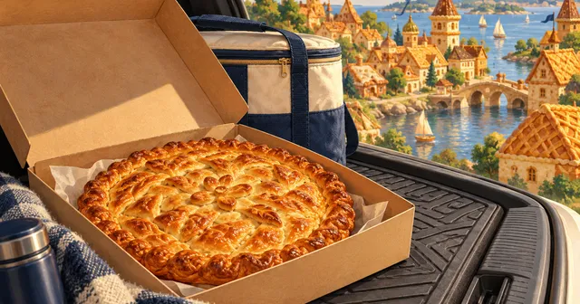

**Обновление** · `/journal/kak-perevezti-pirog/` · Приёмы и хранение

- **Вопрос читателя.** Довезти пирог в машине или электричке.
- **Что добавить.** Сравнить коробки и фиксацию; отдельные сценарии с сухой и влажной начинкой; действия по приезде.
- **SEO-заголовок.** Как перевезти пирог зимой: коробка, фиксация и подача | Пирогорск
- **Описание.** Как подобрать коробку, зафиксировать пирог и довезти его зимой в машине или электричке. Что сделать по приезде.
- **Перелинковка.** [kak-hranit-pirogi](https://pirogorsk.ru/journal/kak-hranit-pirogi/), [kak-razogret-pirog-v-apartamentah](https://pirogorsk.ru/journal/kak-razogret-pirog-v-apartamentah/), [kak-narezat-pirog](https://pirogorsk.ru/journal/kak-narezat-pirog/). [Посмотреть пироги и начинки](https://pirogorsk.ru/menu/).
- **Обложка.** Пирог в открытой коробке и термосумка для дороги на фоне иллюстрированного пирогового города. Действующая обложка статьи.
- **Две врезки.** Разрез с фиксаторами и памятка перед выходом.
- **До выпуска.** Условия хранения проверять для конкретного пирога, не обещать безопасную перевозку без учёта температуры.
- **Источники.** [Роспотребнадзор — рекомендации к праздничному столу](https://zpp.rospotrebnadzor.ru/news/federal/570062), [King Arthur Baking — How to Bake Pie](https://www.kingarthurbaking.com/learn/pie).

## CNT-115 · 03.12 · Сладкая выпечка к зимнему чаепитию

**Обновление** · `/journal/sladkie-pirogi-k-chayu/` · Стол и подача

- **Вопрос читателя.** Выбрать сладкий пирог по начинке и количеству гостей.
- **Что добавить.** Добавить сценарии на 4, 6 и 8; сравнить фруктовую, творожную и ягодную начинки; дать ссылки на рецепты и наборы.
- **SEO-заголовок.** Сладкая выпечка к зимнему чаепитию | Пирогорск
- **Описание.** Фруктовые, ягодные и творожные пироги к чаю. Примеры зимнего чаепития на 4, 6 и 8 гостей.
- **Перелинковка.** [chto-pit-s-pirogami](https://pirogorsk.ru/journal/chto-pit-s-pirogami/), [pirog-s-vishney-nachinka](https://pirogorsk.ru/journal/pirog-s-vishney-nachinka/), [yablochnyy-pirog-v-duhovke](https://pirogorsk.ru/journal/yablochnyy-pirog-v-duhovke/). [Рассчитать количество пирогов](https://pirogorsk.ru/podbor/).
- **Обложка.** Куски яблочного, вишнёвого и творожного пирогов к чаю на фоне иллюстрированного пирогового города. Действующая обложка статьи.
- **Две врезки.** Таблица вкусов и две подачи к общему столу.
- **До выпуска.** Сохранить текущий URL и прежние сочетания. Даты и примеры подавать как редакционные сценарии.
- **Источники.** [Калькулятор Пирогорска](https://pirogorsk.ru/podbor/), [King Arthur Baking — How to Bake Pie](https://www.kingarthurbaking.com/learn/pie).

## CNT-116 · 04.12 · Слоёные пирожки с грибами: маленькие порции в духовке

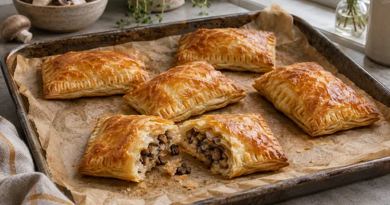

**Новая статья** · `/journal/sloenye-pirozhki-s-gribami/` · Рецепты

- **Вопрос читателя.** Испечь порционную выпечку из готового слоёного теста.
- **Что добавить.** Как осушить начинку, нарезать пласты, запечатать края и испечь на одном противне; примеры размеров.
- **SEO-заголовок.** Слоёные пирожки с грибами: маленькие порции в духовке | Пирогорск
- **Описание.** Маленькие пирожки из готового слоёного теста с грибами. Подготовка начинки, раскрой листа, защипы и выпечка на одном противне.
- **Перелинковка.** [sloenoe-ili-drozhzhevoe-testo](https://pirogorsk.ru/journal/sloenoe-ili-drozhzhevoe-testo/), [mini-pirogi-ili-tselyy-pirog](https://pirogorsk.ru/journal/mini-pirogi-ili-tselyy-pirog/), [pochemu-u-piroga-syroe-dno](https://pirogorsk.ru/journal/pochemu-u-piroga-syroe-dno/). [Посмотреть пироги и начинки](https://pirogorsk.ru/menu/).
- **Обложка.** Небольшие слоёные пирожки и начинка из грибов. [Исходник PNG](artwork/sloenye-pirozhki-s-gribami.png) · [OG 1200×630](og/sloenye-pirozhki-s-gribami.jpg).
- **Две врезки.** Шаблон раскроя листа и крупный план защипа.
- **До выпуска.** Сверить инструкцию теста. Отделить от рецепта большого пирога и сравнения размеров.
- **Источники.** [King Arthur Baking — Pie Baking Guide](https://www.kingarthurbaking.com/learn/guides/pie-baking), [King Arthur Baking — How to Bake Pie](https://www.kingarthurbaking.com/learn/pie), [Роспотребнадзор — рекомендации к праздничному столу](https://zpp.rospotrebnadzor.ru/news/federal/570062).

## CNT-117 · 05.12 · Где поесть в Светлогорске зимой между прогулками

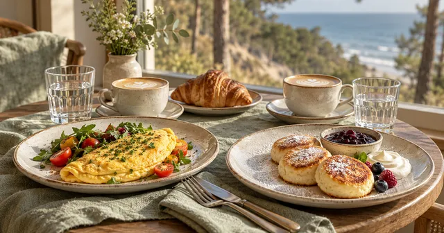

**Обновление** · `/journal/gde-poest-v-svetlogorske/` · Городские гиды · Светлогорск

- **Вопрос читателя.** Выбрать место для обеда на короткой поездке.
- **Что добавить.** Добавить дождливый маршрут и варианты формата между вокзалом, центром и морем; обновить действующие ссылки.
- **SEO-заголовок.** Где поесть в Светлогорске зимой между прогулками | Пирогорск
- **Описание.** Где поесть зимой в Светлогорске между вокзалом, центром и морем. Идеи тёплой остановки и маршрут на дождливый день.
- **Перелинковка.** [pekarni-svetlogorska](https://pirogorsk.ru/journal/pekarni-svetlogorska/), [eda-s-soboy-v-svetlogorske](https://pirogorsk.ru/journal/eda-s-soboy-v-svetlogorske/), [nedorogo-poest-semey-v-svetlogorske](https://pirogorsk.ru/journal/nedorogo-poest-semey-v-svetlogorske/). [Посмотреть подборки для Светлогорска](https://pirogorsk.ru/svetlogorsk/).
- **Обложка.** Омлет, сырники и кофе у окна с соснами и морем. Действующая обложка статьи.
- **Две врезки.** Схема погодных развилок и таблица остановок.
- **До выпуска.** Зимняя доступность спусков и часы кафе требуют проверки у владельцев и властей.
- **Источники.** [Туристический центр — Светлогорск](https://visit-kaliningrad.ru/blog/svetlogorsk/), [Туристический центр — календарь Калининградской области](https://visit-kaliningrad.ru/calendar/).

## CNT-118 · 06.12 · Как хранить пироги с разными начинками после застолья

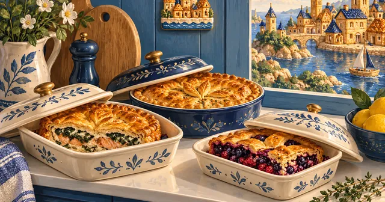

**Обновление** · `/journal/kak-hranit-pirogi/` · Приёмы и хранение

- **Вопрос читателя.** Решить, что убрать и как разделить остатки.
- **Что добавить.** Уточнить упаковку, маркировку времени и разницу между сухой и влажной начинкой; дать компактное дерево решений.
- **SEO-заголовок.** Как хранить пироги с разными начинками после застолья | Пирогорск
- **Описание.** Как убрать остатки пирогов после застолья. Упаковка, маркировка и условия хранения для сухих и влажных начинок.
- **Перелинковка.** [kak-zamorozit-pirog](https://pirogorsk.ru/journal/kak-zamorozit-pirog/), [kak-razogret-pirog-v-apartamentah](https://pirogorsk.ru/journal/kak-razogret-pirog-v-apartamentah/), [sostav-piroga-i-allergeny](https://pirogorsk.ru/journal/sostav-piroga-i-allergeny/). [Посмотреть пироги и начинки](https://pirogorsk.ru/menu/).
- **Обложка.** Разные пироги в закрывающихся керамических формах на фоне иллюстрированного пирогового города. Действующая обложка статьи.
- **Две врезки.** Дерево действий и пример подписанного контейнера.
- **До выпуска.** Точные сроки только по маркировке или подходящим утверждённым источникам.
- **Источники.** [Роспотребнадзор — рекомендации к праздничному столу](https://zpp.rospotrebnadzor.ru/news/federal/570062), [King Arthur Baking — Freeze Pie Crust](https://www.kingarthurbaking.com/blog/2025/11/05/freeze-pie-crust).

## CNT-119 · 07.12 · Как испечь два пирога в одной духовке

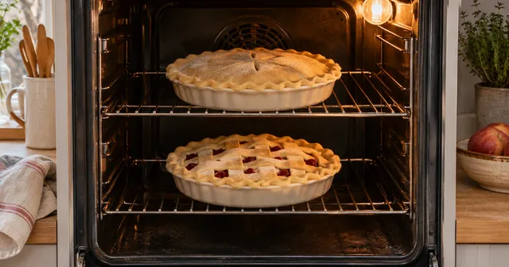

**Новая статья** · `/journal/kak-ispech-dva-piroga-v-odnoy-duhovke/` · Приёмы и хранение

- **Вопрос читателя.** Понять, когда ставить две формы одновременно, а когда печь по очереди.
- **Что добавить.** Сравнить один и два уровня; проверить совместимость режимов; действия при неравномерном подрумянивании; тайминг для разных рецептов.
- **SEO-заголовок.** Как испечь два пирога в одной духовке | Пирогорск
- **Описание.** Можно ли поставить две формы в одну духовку? Когда совместить выпечку, как выбрать уровни и что делать при разном подрумянивании.
- **Перелинковка.** [pochemu-u-piroga-syroe-dno](https://pirogorsk.ru/journal/pochemu-u-piroga-syroe-dno/), [pochemu-pirog-treskaetsya](https://pirogorsk.ru/journal/pochemu-pirog-treskaetsya/), [pirog-na-skovorode-ili-v-duhovke](https://pirogorsk.ru/journal/pirog-na-skovorode-ili-v-duhovke/). [Посмотреть пироги и начинки](https://pirogorsk.ru/menu/).
- **Обложка.** Две формы на уровнях духовки с хорошим зазором. [Исходник PNG](artwork/kak-ispech-dva-piroga-v-odnoy-duhovke.png) · [OG 1200×630](og/kak-ispech-dva-piroga-v-odnoy-duhovke.jpg).
- **Две врезки.** Схема уровней и план выпечки при совпадающих и разных режимах.
- **До выпуска.** Подтвердить рекомендации инструкцией модели и сравнительной пробой, не обобщать на все духовки.
- **Источники.** [King Arthur Baking — Pie Baking Guide](https://www.kingarthurbaking.com/learn/guides/pie-baking), [King Arthur Baking — How to Bake Pie](https://www.kingarthurbaking.com/learn/pie).

## CNT-120 · 08.12 · Слоёное дрожжевое и бездрожжевое тесто: что взять для пирога

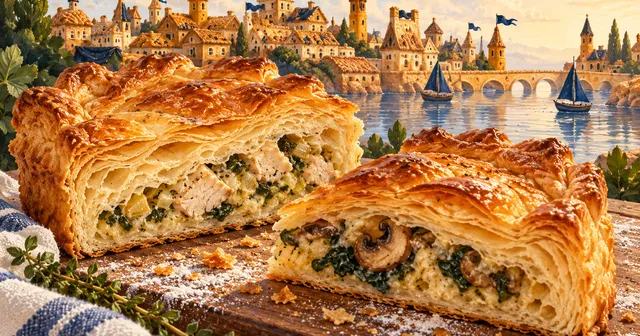

**Обновление** · `/journal/sloenoe-ili-drozhzhevoe-testo/` · Приёмы и хранение

- **Вопрос читателя.** Выбрать тип теста под начинку и ожидаемую корку.
- **Что добавить.** Добавить таблицу на 4 изделия и фотографии сравнительных разрезов; показать, как читать инструкцию упаковки.
- **SEO-заголовок.** Слоёное дрожжевое и бездрожжевое тесто: что взять для пирога | Пирогорск
- **Описание.** Чем отличаются дрожжевое и бездрожжевое слоёное тесто и как выбрать основу для пирожков, пирогов и открытых тартов.
- **Перелинковка.** [drozhzhevoe-testo-dlya-pirogov](https://pirogorsk.ru/journal/drozhzhevoe-testo-dlya-pirogov/), [pesochnoe-testo-dlya-kisha](https://pirogorsk.ru/journal/pesochnoe-testo-dlya-kisha/), [pochemu-u-piroga-syroe-dno](https://pirogorsk.ru/journal/pochemu-u-piroga-syroe-dno/). [Посмотреть пироги и начинки](https://pirogorsk.ru/menu/).
- **Обложка.** Слоёный пирог в разрезе с заметными слоями теста на фоне иллюстрированного пирогового города. Действующая обложка статьи.
- **Две врезки.** Парный разрез и матрица задач по типам теста.
- **До выпуска.** Отдельно обозначить слоёное дрожжевое и обычное дрожжевое, не смешивать категории.
- **Источники.** [King Arthur Baking — Pie Baking Guide](https://www.kingarthurbaking.com/learn/guides/pie-baking), [King Arthur Baking — How to Bake Pie](https://www.kingarthurbaking.com/learn/pie), [King Arthur Baking — Pie Crust Guide](https://www.kingarthurbaking.com/learn/guides/pie-crust).

## CNT-121 · 09.12 · Закрытый пирог с рыбой и рисом в духовке

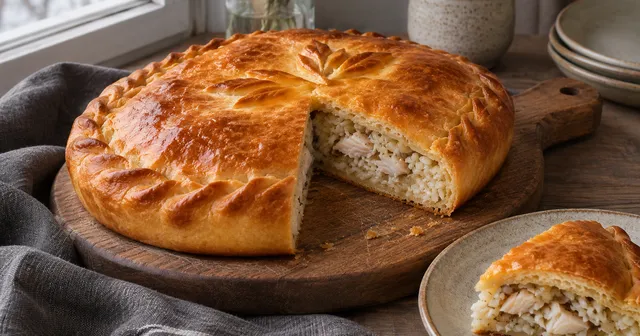

**Новая статья** · `/journal/pirog-s-ryboy-i-risom-v-duhovke/` · Рецепты

- **Вопрос читателя.** Испечь сытный рыбный пирог по проверенной раскладке.
- **Что добавить.** Разобрать рыбу, рис и тесто раздельно; показать охлаждение начинки, сборку, готовность и разрез.
- **SEO-заголовок.** Закрытый пирог с рыбой и рисом в духовке | Пирогорск
- **Описание.** Закрытый рыбный пирог с рисом в духовке. Как подготовить рыбу и рис, собрать пирог и проверить готовность начинки.
- **Перелинковка.** [rybnaya-nachinka-dlya-piroga](https://pirogorsk.ru/journal/rybnaya-nachinka-dlya-piroga/), [ryba-baltiki-vidy](https://pirogorsk.ru/journal/ryba-baltiki-vidy/), [pochemu-u-piroga-syroe-dno](https://pirogorsk.ru/journal/pochemu-u-piroga-syroe-dno/). [Посмотреть пироги и начинки](https://pirogorsk.ru/menu/).
- **Обложка.** Закрытый рыбный пирог с рисом в разрезе. [Исходник PNG](artwork/pirog-s-ryboy-i-risom-v-duhovke.png) · [OG 1200×630](og/pirog-s-ryboy-i-risom-v-duhovke.jpg).
- **Две врезки.** Вид подготовленной начинки и крупный план шва.
- **До выпуска.** Проверить рецепт и безопасную готовность по источникам для выбранной рыбы.
- **Источники.** [King Arthur Baking — Pie Baking Guide](https://www.kingarthurbaking.com/learn/guides/pie-baking), [King Arthur Baking — How to Bake Pie](https://www.kingarthurbaking.com/learn/pie), [Роспотребнадзор — рекомендации к праздничному столу](https://zpp.rospotrebnadzor.ru/news/federal/570062).

## CNT-122 · 10.12 · Еда в Храброво зимой: что взять до вылета

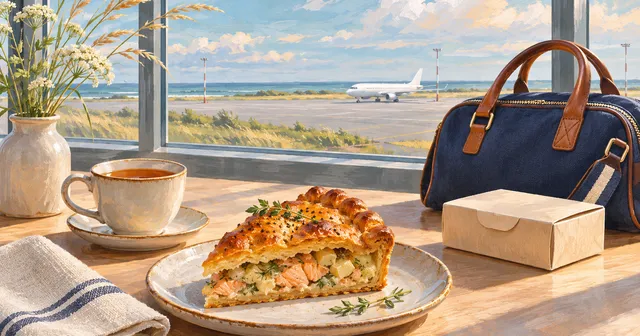

**Обновление** · `/journal/eda-v-aeroportu-hrabrovo/` · Городские гиды · Калининград и область

- **Вопрос читателя.** Выбрать перекус до или после зоны досмотра.
- **Что добавить.** Уточнить где купить еду, когда выезжать и что брать домашним перекусом; разделить зоны и подвести к источникам правил.
- **SEO-заголовок.** Еда в Храброво зимой: что взять до вылета | Пирогорск
- **Описание.** Где искать еду в Храброво и что проверить перед вылетом. Варианты перекуса до и после досмотра.
- **Перелинковка.** [sedobnye-suveniry-iz-kaliningrada](https://pirogorsk.ru/journal/sedobnye-suveniry-iz-kaliningrada/), [kak-perevezti-pirog](https://pirogorsk.ru/journal/kak-perevezti-pirog/), [rynki-kaliningrada-eda](https://pirogorsk.ru/journal/rynki-kaliningrada-eda/). [Посмотреть подборки для Калининграда](https://pirogorsk.ru/kaliningrad/).
- **Обложка.** Пирог, чай и дорожная коробка на столе у окна с самолётом и светлым балтийским небом. Действующая обложка статьи.
- **Две врезки.** Таблица до / после контроля и список проверок перед выездом.
- **До выпуска.** Всё зависящее от перевозчика и даты указывать только по официальным правилам.
- **Источники.** [Храброво — действующие сведения аэропорта](https://kgdavia.ru/), [Туристический центр — календарь Калининградской области](https://visit-kaliningrad.ru/calendar/), [Роспотребнадзор — рекомендации к праздничному столу](https://zpp.rospotrebnadzor.ru/news/federal/570062).

## CNT-123 · 11.12 · Зимний офисный кофе-брейк: пироги и подача по времени

**Обновление** · `/journal/pirogi-na-kofe-breyk/` · Стол и подача

- **Вопрос читателя.** Рассчитать небольшой перерыв без очередей к столу.
- **Что добавить.** Сценарии на 12 и 24 человека; выкладка в две точки; одноразовая или возвратная подача; как разложить изделия по составу.
- **SEO-заголовок.** Зимний офисный кофе-брейк: пироги и подача по времени | Пирогорск
- **Описание.** Сколько пирогов поставить на офисный кофе-брейк на 12 или 24 человека. Как разложить куски и подписать начинки.
- **Перелинковка.** [obed-v-ofis-v-kaliningrade](https://pirogorsk.ru/journal/obed-v-ofis-v-kaliningrade/), [skolko-piroga-na-cheloveka](https://pirogorsk.ru/journal/skolko-piroga-na-cheloveka/), [mini-pirogi-ili-tselyy-pirog](https://pirogorsk.ru/journal/mini-pirogi-ili-tselyy-pirog/). [Рассчитать количество пирогов](https://pirogorsk.ru/podbor/).
- **Обложка.** Мини-пироги, чашки и кофейники для кофе-брейка на фоне иллюстрированного пирогового города. Действующая обложка статьи.
- **Две врезки.** План двух точек подачи и схема порций на 12 и 24.
- **До выпуска.** Расчёт перепроверить на двух примерах, не обещать действующие кейтеринг и доставку.
- **Источники.** [Калькулятор Пирогорска](https://pirogorsk.ru/podbor/), [Роспотребнадзор — рекомендации к праздничному столу](https://zpp.rospotrebnadzor.ru/news/federal/570062).

## CNT-124 · 12.12 · Слойки с яблоками из готового теста

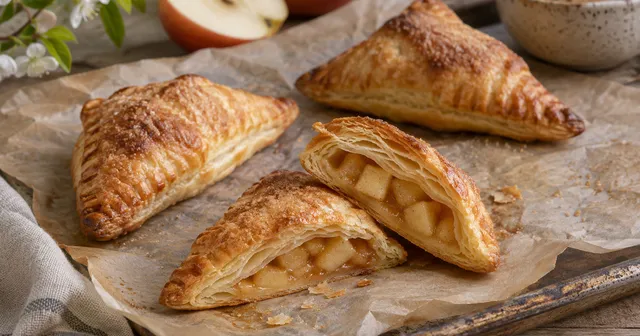

**Новая статья** · `/journal/sloyki-s-yablokami-v-duhovke/` · Рецепты

- **Вопрос читателя.** Приготовить порционные слойки вместо большого пирога.
- **Что добавить.** Сорт яблок, толщина нарезки, контроль сока; два способа складывания, признаки готовности и подача.
- **SEO-заголовок.** Слойки с яблоками из готового теста | Пирогорск
- **Описание.** Слойки с яблоками из готового теста в духовке. Как нарезать начинку, уменьшить вытекание сока и сложить изделия двумя способами.
- **Перелинковка.** [yabloki-dlya-piroga](https://pirogorsk.ru/journal/yabloki-dlya-piroga/), [yablochnyy-pirog-v-duhovke](https://pirogorsk.ru/journal/yablochnyy-pirog-v-duhovke/), [sloenoe-ili-drozhzhevoe-testo](https://pirogorsk.ru/journal/sloenoe-ili-drozhzhevoe-testo/). [Посмотреть пироги и начинки](https://pirogorsk.ru/menu/).
- **Обложка.** Порционные яблочные слойки с видимыми слоями корки. [Исходник PNG](artwork/sloyki-s-yablokami-v-duhovke.png) · [OG 1200×630](og/sloyki-s-yablokami-v-duhovke.jpg).
- **Две врезки.** Две формы сложения и начинка до выпечки.
- **До выпуска.** Проверить рецепт на конкретном тесте и отделить интент от шарлотки.
- **Источники.** [King Arthur Baking — How to Bake Pie](https://www.kingarthurbaking.com/learn/pie), [King Arthur Baking — Pie Baking Guide](https://www.kingarthurbaking.com/learn/guides/pie-baking), [King Arthur Baking — загустители для фруктовых пирогов](https://www.kingarthurbaking.com/learn/guides/pie-thickener).

## CNT-125 · 13.12 · Как сделать начинку для вишнёвого пирога из замороженных ягод

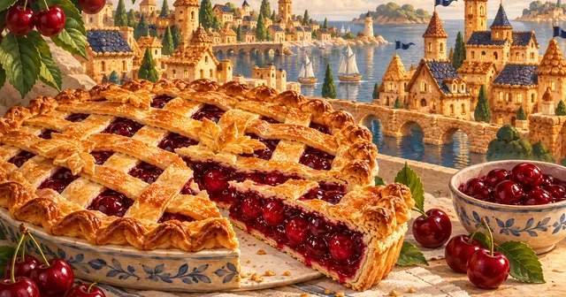

**Обновление** · `/journal/pirog-s-vishney-nachinka/` · Приёмы и хранение

- **Вопрос читателя.** Удержать сок, сохранив ягоды в начинке.
- **Что добавить.** Разобрать подготовку замороженной вишни, охлаждение загущённой начинки и признаки избытка влаги.
- **SEO-заголовок.** Как сделать начинку для вишнёвого пирога из замороженных ягод | Пирогорск
- **Описание.** Как подготовить замороженную вишню для пирога и загустить начинку. Что проверить перед сборкой и выпечкой.
- **Перелинковка.** [pochemu-u-piroga-syroe-dno](https://pirogorsk.ru/journal/pochemu-u-piroga-syroe-dno/), [sladkie-pirogi-k-chayu](https://pirogorsk.ru/journal/sladkie-pirogi-k-chayu/), [kak-zamorozit-pirog](https://pirogorsk.ru/journal/kak-zamorozit-pirog/). [Посмотреть пироги и начинки](https://pirogorsk.ru/menu/).
- **Обложка.** Вишнёвый пирог с решёткой и вишня в миске на фоне иллюстрированного пирогового города. Действующая обложка статьи.
- **Две врезки.** Три стадии загущения и разрез корки после остывания.
- **До выпуска.** Привязать дозировки к весу ягод и виду загустителя, проверить на тестовой порции.
- **Источники.** [King Arthur Baking — How to Bake Pie](https://www.kingarthurbaking.com/learn/pie), [King Arthur Baking — Pie Baking Guide](https://www.kingarthurbaking.com/learn/guides/pie-baking), [King Arthur Baking — Pie Crust Guide](https://www.kingarthurbaking.com/learn/guides/pie-crust), [King Arthur Baking — загустители для фруктовых пирогов](https://www.kingarthurbaking.com/learn/guides/pie-thickener).

## CNT-126 · 14.12 · Пирог с клюквой и апельсином: зимний рецепт

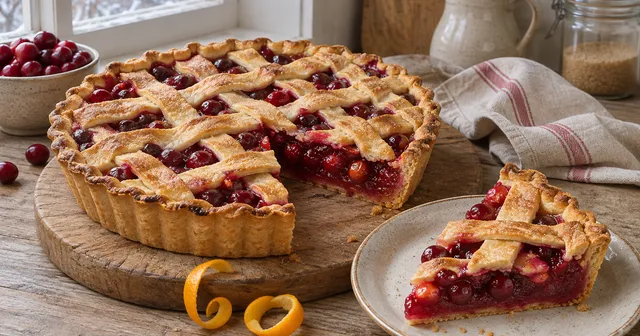

**Новая статья** · `/journal/pirog-s-klyukvoy-i-apelsinom/` · Рецепты

- **Вопрос читателя.** Испечь ягодный пирог с цитрусовой ноткой и контролем кислоты.
- **Что добавить.** Клюква свежая или замороженная; цедра и сок; выпечка на выбранной основе и варианты подачи.
- **SEO-заголовок.** Пирог с клюквой и апельсином: зимний рецепт | Пирогорск
- **Описание.** Зимний пирог с клюквой и апельсином. Подготовка ягод и цедры, сборка фруктовой начинки и подача после остывания.
- **Перелинковка.** [pirog-s-brusnikoy-sochetaniya](https://pirogorsk.ru/journal/pirog-s-brusnikoy-sochetaniya/), [pirog-s-vishney-nachinka](https://pirogorsk.ru/journal/pirog-s-vishney-nachinka/), [sladkie-pirogi-k-chayu](https://pirogorsk.ru/journal/sladkie-pirogi-k-chayu/). [Посмотреть пироги и начинки](https://pirogorsk.ru/menu/).
- **Обложка.** Невысокий пирог с клюквой, рядом апельсиновая цедра. [Исходник PNG](artwork/pirog-s-klyukvoy-i-apelsinom.png) · [OG 1200×630](og/pirog-s-klyukvoy-i-apelsinom.jpg).
- **Две врезки.** Подготовка ягод и разрез после остывания.
- **До выпуска.** Сверить фактическую рецептуру. Не представлять клюкву и бруснику как взаимозаменяемые без адаптации.
- **Источники.** [King Arthur Baking — How to Bake Pie](https://www.kingarthurbaking.com/learn/pie), [King Arthur Baking — Pie Baking Guide](https://www.kingarthurbaking.com/learn/guides/pie-baking), [King Arthur Baking — Pie Crust Guide](https://www.kingarthurbaking.com/learn/guides/pie-crust), [King Arthur Baking — загустители для фруктовых пирогов](https://www.kingarthurbaking.com/learn/guides/pie-thickener).

## CNT-127 · 15.12 · Пекарни Светлогорска зимой: где купить выпечку по пути

**Обновление** · `/journal/pekarni-svetlogorska/` · Городские гиды · Светлогорск

- **Вопрос читателя.** Найти вариант на вынос по проверенному маршруту.
- **Что добавить.** Перепроверить адреса и часы; добавить вариант от станции до центра и обозначить, что доступно утром.
- **SEO-заголовок.** Пекарни Светлогорска зимой: где купить выпечку по пути | Пирогорск
- **Описание.** Где купить выпечку в Светлогорске зимой по дороге от станции до центра. Ориентиры, подтверждённые адреса и часы работы.
- **Перелинковка.** [gde-poest-v-svetlogorske](https://pirogorsk.ru/journal/gde-poest-v-svetlogorske/), [eda-s-soboy-v-svetlogorske](https://pirogorsk.ru/journal/eda-s-soboy-v-svetlogorske/), [hleb-i-vypechka-kaliningradskoy-oblasti](https://pirogorsk.ru/journal/hleb-i-vypechka-kaliningradskoy-oblasti/). [Посмотреть подборки для Светлогорска](https://pirogorsk.ru/svetlogorsk/).
- **Обложка.** Редакционная иллюстрация: хлеб, круассан и фруктовые слойки в крафтовом пакете у вымышленного окна на балтийский город. Действующая обложка статьи.
- **Две врезки.** Маршрут от станции и таблица часов и ссылок.
- **До выпуска.** Цены и наличие указывать только на дату, с прямой ссылкой на источник.
- **Источники.** [Туристический центр — Светлогорск](https://visit-kaliningrad.ru/blog/svetlogorsk/), [Туристический центр — календарь Калининградской области](https://visit-kaliningrad.ru/calendar/).

## CNT-128 · 16.12 · Что сделать из обрезков теста для пирога

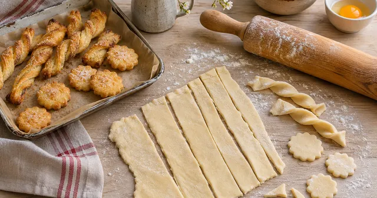

**Новая статья** · `/journal/chto-sdelat-iz-ostatkov-testa-dlya-piroga/` · Приёмы и хранение

- **Вопрос читателя.** Использовать небольшие обрезки слоёного, песочного и дрожжевого теста.
- **Что добавить.** Три сценария по типу теста; что можно собирать в один пласт; раскладка и готовность небольших изделий.
- **SEO-заголовок.** Что сделать из обрезков теста для пирога | Пирогорск
- **Описание.** Три способа использовать обрезки песочного, дрожжевого и слоёного теста. Как собрать заготовки и испечь небольшие изделия.
- **Перелинковка.** [pesochnoe-testo-dlya-kisha](https://pirogorsk.ru/journal/pesochnoe-testo-dlya-kisha/), [sloenoe-ili-drozhzhevoe-testo](https://pirogorsk.ru/journal/sloenoe-ili-drozhzhevoe-testo/), [drozhzhevoe-testo-dlya-pirogov](https://pirogorsk.ru/journal/drozhzhevoe-testo-dlya-pirogov/). [Посмотреть пироги и начинки](https://pirogorsk.ru/menu/).
- **Обложка.** Разные обрезки теста и небольшие изделия на пергаменте. [Исходник PNG](artwork/chto-sdelat-iz-ostatkov-testa-dlya-piroga.png) · [OG 1200×630](og/chto-sdelat-iz-ostatkov-testa-dlya-piroga.jpg).
- **Две врезки.** Три раскладки обрезков и примеры готовых изделий.
- **До выпуска.** Проверить три способа с весом остатков. Сырые обрезки и остатки готовой выпечки описывать отдельно.
- **Источники.** [King Arthur Baking — How to Bake Pie](https://www.kingarthurbaking.com/learn/pie), [King Arthur Baking — Pie Baking Guide](https://www.kingarthurbaking.com/learn/guides/pie-baking), [King Arthur Baking — Pie Crust Guide](https://www.kingarthurbaking.com/learn/guides/pie-crust).

## CNT-129 · 17.12 · Что пить с пирогами зимой: чай, морс и кофе

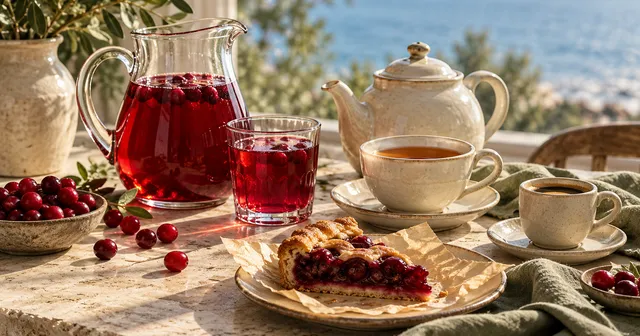

**Обновление** · `/journal/chto-pit-s-pirogami/` · Стол и подача

- **Вопрос читателя.** Подобрать безалкогольный напиток к сладкой и сытной выпечке.
- **Что добавить.** Собрать 5 сочетаний, указать кислотность и сладость на примерах; добавить вариант без кофеина и два способа подачи.
- **SEO-заголовок.** Что пить с пирогами зимой: чай, морс и кофе | Пирогорск
- **Описание.** Пять сочетаний сытных и сладких пирогов с чаем, кофе и морсом. Идеи подачи зимой и вариант без кофеина.
- **Перелинковка.** [sladkie-pirogi-k-chayu](https://pirogorsk.ru/journal/sladkie-pirogi-k-chayu/), [napitki-kaliningradskoy-oblasti](https://pirogorsk.ru/journal/napitki-kaliningradskoy-oblasti/), [pirog-s-brusnikoy-sochetaniya](https://pirogorsk.ru/journal/pirog-s-brusnikoy-sochetaniya/). [Рассчитать количество пирогов](https://pirogorsk.ru/podbor/).
- **Обложка.** Ягодный напиток, чай и кофе рядом с кусочком вишнёвого пирога. Действующая обложка статьи.
- **Две врезки.** Матрица сочетаний и пример двух подач.
- **До выпуска.** Проверить текущий каталог и не выдавать вкусовые сочетания за личную дегустацию.
- **Источники.** [Калькулятор Пирогорска](https://pirogorsk.ru/podbor/), [King Arthur Baking — How to Bake Pie](https://www.kingarthurbaking.com/learn/pie).

## CNT-130 · 18.12 · Строганина из пеламиды в Калининграде: где искать в меню

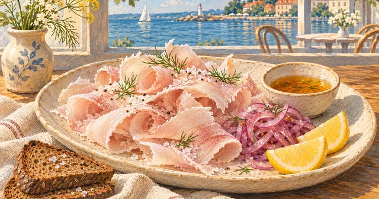

**Обновление** · `/journal/stroganina-iz-pelamidy/` · Городские гиды · Калининград и область

- **Вопрос читателя.** Понять роль блюда и найти проверенное ресторанное меню.
- **Что добавить.** Разнести исторический контекст и места, где блюдо заявлено; отметить дату проверки, обновить терминологию и перелинковку.
- **SEO-заголовок.** Строганина из пеламиды в Калининграде: где искать в меню | Пирогорск
- **Описание.** Что называют строганиной из пеламиды в Калининграде и как искать её в актуальном меню. История блюда и ссылки с датой проверки.
- **Перелинковка.** [ryba-baltiki-vidy](https://pirogorsk.ru/journal/ryba-baltiki-vidy/), [kak-edyat-rybu-v-kaliningradskoy-oblasti](https://pirogorsk.ru/journal/kak-edyat-rybu-v-kaliningradskoy-oblasti/), [regionalnaya-kuhnya-kaliningradskoy-oblasti](https://pirogorsk.ru/journal/regionalnaya-kuhnya-kaliningradskoy-oblasti/). [Посмотреть подборки для Калининграда](https://pirogorsk.ru/kaliningrad/).
- **Обложка.** Редакционная иллюстрация: тонкие ломтики рыбы на тарелке, красный лук, лимон, хлеб и отдельный соус у вымышленного балтийского окна. Действующая обложка статьи.
- **Две врезки.** Набор ссылок на актуальные меню и схема различия названий.
- **До выпуска.** Проверить меню непосредственно у ресторанов. При отсутствии актуальных меню оставить справочный материал без списка заведений.
- **Источники.** [Туристический центр — Калининград](https://visit-kaliningrad.ru/blog/kaliningrad-za-3-dnya/), [Роспотребнадзор — рекомендации к праздничному столу](https://zpp.rospotrebnadzor.ru/news/federal/570062), [Туристический центр — календарь Калининградской области](https://visit-kaliningrad.ru/calendar/).
